# Compte rendu — Observer HTTP : du navigateur à Wireshark

**Environnement :** Windows 11, WAMP (Apache 2.4.65, PHP 8.3.28), Firefox 161, Wireshark 4.6 avec Npcap (option *Support loopback traffic*)
**Dossier :** `C:\wamp64\www\tp-http` — **URL de test :** `http://localhost/tp-http/formulaire.php`

**Fichiers du dépôt**

| Fichier | Rôle |
| --- | --- |
| `formulaire.php` | Page qui reçoit un nom en GET ou en POST |
| `redirige.php` | Page qui redirige (302) vers `formulaire.php` |
| `statique.html` | Page statique utilisée pour observer le cache (304) |
| `captures/tp2-http.pcapng` | Capture sur la boucle locale, filtre `tcp port 80` : GET, POST, 404, 302, 304 |
| `captures/tp2-dns-https.pcapng` | Capture sur le Wi-Fi : DNS (`nslookup`) et HTTPS vers Wikipédia |
| `captures/flux-tcp.txt` | Texte du flux TCP suivi (*Follow TCP Stream*) |
| `captures/firefox-*.png`, `captures/wireshark-*.png` | Captures d'écran |

---

## Partie 1 — Observation dans le navigateur

**Navigateur :** Firefox 161. Outils de développement ouverts avec **Ctrl+Maj+E** (la touche F12 de l'ordinateur portable active le mode avion), onglet *Réseau*, cases *Désactiver le cache* et *Conserver les journaux* cochées, colonne *Protocole* ajoutée.

### Étape 1 — Requête simple

| Élément à relever | Où le trouver | Valeur observée |
| --- | --- | --- |
| Méthode | En-têtes, ligne de requête | `GET` |
| URL complète | En-têtes | `http://localhost/tp-http/formulaire.php` |
| Code de statut | En-têtes, ligne de statut | `200 OK` |
| Version de HTTP | En-têtes | `HTTP/1.1` |
| `Host` | En-têtes de requête | `localhost` |
| `User-Agent` | En-têtes de requête | `Mozilla/5.0 (Windows NT 10.0; Win64; x64; rv:161.0) Gecko/20100101 Firefox/161.0` |
| `Content-Type` | En-têtes de réponse | `text/html; charset=UTF-8` |
| `Content-Length` | En-têtes de réponse | `370` octets (`377` quand la page affiche « Bonjour IBRAHIM ») |
| `Server` | En-têtes de réponse | `Apache/2.4.65 (Win64) PHP/8.3.28 mod_fcgid/2.3.10-dev` |
| Durée totale | Onglet Délais (*Timings*) | **5 ms**, dont **4 ms d'attente** du serveur. Bloqué, DNS, connexion, TLS et envoi : 0 ms |

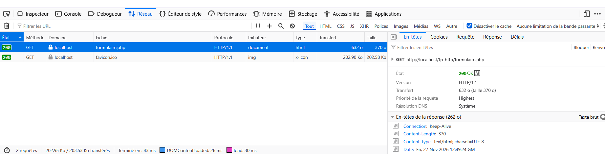

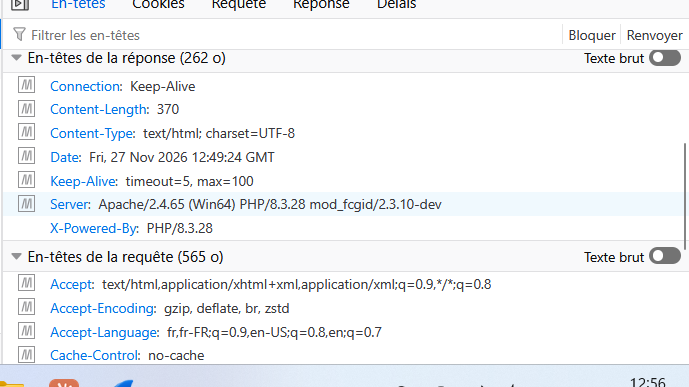

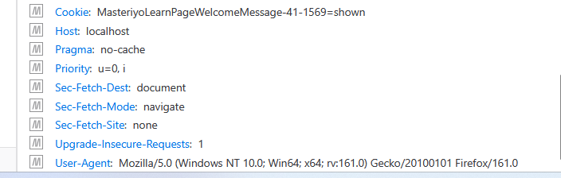

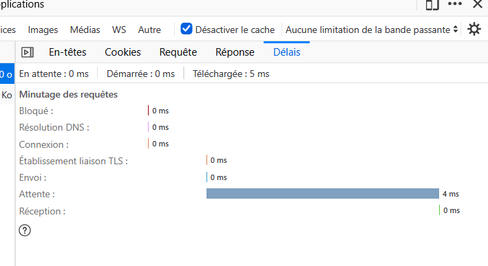

**Lecture des délais :** DNS, connexion et TLS valent 0 ms parce que `localhost` n'a pas besoin de résolution DNS, que la connexion TCP était déjà ouverte (*keep-alive*) et qu'il n'y a pas de TLS en HTTP. Presque tout le temps correspond au travail d'Apache et de PHP.

Autres observations :
- en-têtes de réponse : `X-Powered-By: PHP/8.3.28`, `Connection: Keep-Alive`, `Keep-Alive: timeout=5, max=100` ;
- en-têtes de requête : `Cache-Control: no-cache` et `Pragma: no-cache` (ajoutés à cause de *Désactiver le cache*), `Sec-Fetch-Site: none` (page tapée dans la barre d'adresse) ;
- un cookie `MasteriyoLearnPageWelcomeMessage-...` est envoyé. Il vient d'un autre site installé sur ce `localhost` : un cookie est lié au **nom de domaine**, pas au dossier, donc le navigateur l'envoie à toutes les pages de `localhost` ;
- le navigateur demande aussi tout seul `favicon.ico` (l'icône de l'onglet).

**Remarque sécurité :** `Server` et `X-Powered-By` révèlent les versions exactes d'Apache et de PHP. En production on les masque (`ServerTokens Prod`, `ServerSignature Off`, `expose_php = Off`).

### Étape 2 — Envoi en GET

- Barre d'adresse et requête : `http://localhost/tp-http/formulaire.php?nom=IBRAHIM`
- Le paramètre `nom=IBRAHIM` est dans **l'URL** (chaîne de requête) ; la requête GET n'a **pas de corps** (l'onglet *Requête* de Firefox indique « Aucun paramètre pour cette requête », car il ne montre que le corps).
- Les données arrivent en PHP dans `$_GET['nom']` et la page affiche « Bonjour IBRAHIM ». La réponse passe de 370 à 377 octets (les 7 lettres du nom).
- Nouveaux en-têtes de requête par rapport à l'étape 1 : `Referer: http://localhost/tp-http/formulaire.php` (la page d'où vient le clic), `Sec-Fetch-Site: same-origin`, `Sec-Fetch-User: ?1` (requête déclenchée par un clic).

Détail complet : `captures/firefox-get-entetes.txt`.

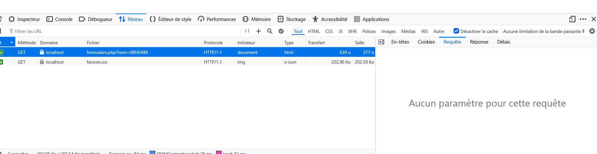

### Étape 3 — Envoi en POST

- Méthode : `POST`, réponse `200 OK`, l'URL ne change pas (`/tp-http/formulaire.php`)
- Corps de la requête : `nom=Ibrahim`
- `Content-Type` de la requête : **`application/x-www-form-urlencoded`**
- `Content-Length` de la requête : **11**, soit exactement `nom=Ibrahim` (4 + 7 octets) : la preuve que le nom voyage dans le **corps**.
- Nouvel en-tête `Origin: http://localhost` : le navigateur indique quel site envoie le formulaire (utile au serveur contre les attaques CSRF).
- Observation : le formulaire n'a pas d'attribut `action`, il est donc envoyé à **l'URL courante**. Lors d'un premier essai, la page affichait encore `?nom=IBRAHIM` (test GET précédent) et le POST est parti vers `formulaire.php?nom=IBRAHIM`. Le PHP lit `$_POST` en premier (`$_POST['nom'] ?? $_GET['nom']`), c'est donc bien la valeur du corps qui est affichée.

Détail complet : `captures/firefox-post-entetes.txt`.

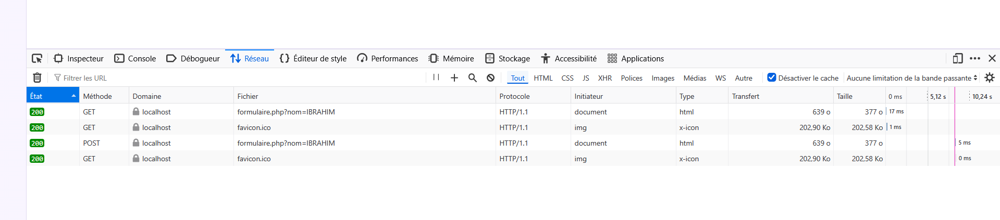

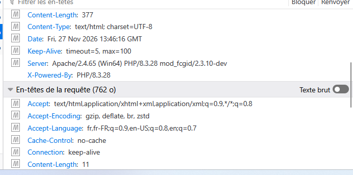

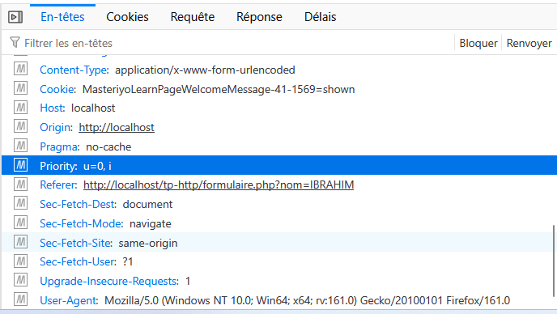

### Étape 4 — Erreur 404

- `http://localhost/tp-http/absent.php` → **`404 Not Found`** (302 octets, environ 2 ms)
- La page affichée est la page d'erreur par défaut d'Apache : titre « Not Found », message « The requested URL was not found on this server », et la signature du serveur en bas (`Apache/2.4.65 (Win64) PHP/8.3.28 mod_fcgid/2.3.10-dev Server at localhost Port 80`), là encore avec les versions.
- Firefox signale aussi l'erreur dans la Console (compteur ❗ en haut des outils).

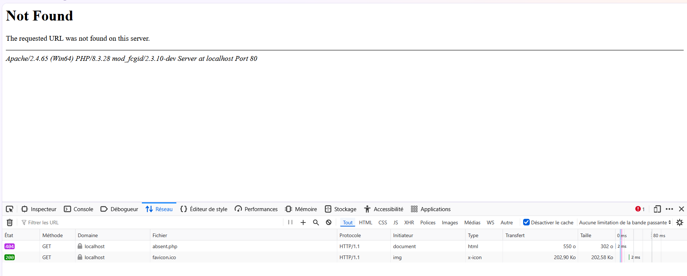

### Étape 5 — Redirection

| # | Requête | Réponse |
| --- | --- | --- |
| 1 | `GET /tp-http/redirige.php` | **`302 Found`**, `Location: formulaire.php`, `Content-Length: 0` (sans corps) |
| 2 | `GET /tp-http/formulaire.php` | `200 OK`, la page du formulaire (370 octets) |

**Explication :** le serveur ne renvoie pas de page, il répond « va voir à l'adresse indiquée dans `Location` ». Le navigateur lit cet en-tête et envoie **automatiquement une nouvelle requête GET** vers `formulaire.php`, environ 2 ms plus tard. L'utilisateur ne voit que la page finale : la barre d'adresse affiche `formulaire.php`.

**Ce qui s'est passé dans Firefox :** malgré *Conserver les journaux*, le panneau Réseau de Firefox n'a affiché que la requête finale `formulaire.php` (200), pas la ligne 302. Deux autres difficultés sont apparues : le panneau fermé au moment du chargement n'enregistre rien, et la saisie automatique de la barre d'adresse remplaçait `redirige.php` par `formulaire.php`. Le journal d'Apache (`access.log`) et Wireshark confirment pourtant les deux allers-retours. Dans `tp2-http.pcapng`, paquets **133 à 139** :

```
133  GET /tp-http/redirige.php HTTP/1.1
135  HTTP/1.1 302 Found          (Location: formulaire.php, Content-Length: 0)
137  GET /tp-http/formulaire.php HTTP/1.1     ← 2 ms plus tard, sur la même connexion
139  HTTP/1.1 200 OK  (text/html)
```

C'est justement l'intérêt du second outil : Wireshark montre ce qui circule réellement, même quand l'affichage du navigateur le masque.

### Étape 6 — Cache (304)

Fichier : `http://localhost/tp-http/statique.html`, *Désactiver le cache* décoché, puis rechargement (↻).

| Chargement | Code | Détail |
| --- | --- | --- |
| 1ᵉʳ | `200 OK` | Le serveur envoie le fichier (183 octets) avec `Last-Modified: Mon, 23 Nov 2026 22:00:18 GMT` et `ETag: "b7-660f8b82889c6"` |
| 2ᵉ | **`304 Not Modified`** | Colonne Transfert : « mis en cache », barre du bas : **0 o transférés** |

En-têtes envoyés par Firefox au 2ᵉ chargement :

```
If-Modified-Since: Mon, 23 Nov 2026 22:00:18 GMT
If-None-Match: "b7-660f8b82889c6"
```

Firefox renvoie la date et l'empreinte (`ETag`) reçues au premier chargement. Le fichier n'ayant pas changé, Apache répond 304 avec seulement des en-têtes (462 o), sans renvoyer le contenu. Dans Wireshark : paquets 254 à 256 (200) puis 265 à 267 (304).

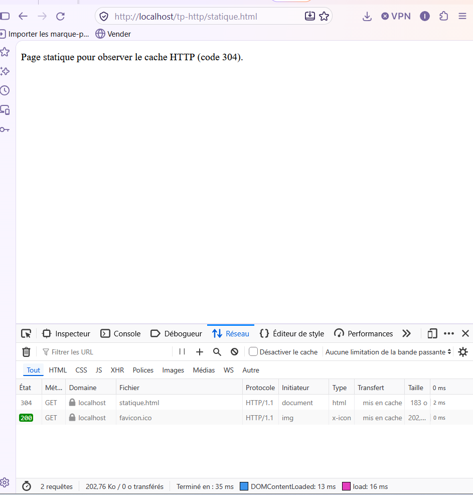

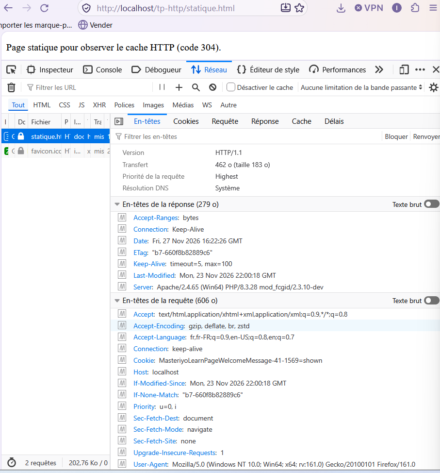

### Étape 7 — Un vrai site

Site observé : `https://www.franceinfo.fr`, rechargé avec le panneau Réseau ouvert et le cache désactivé.

| Mesure | Valeur |
| --- | --- |
| Nombre de requêtes | **230** (234 quelques secondes plus tard) |
| Volume | **3,59 Mo transférés** pour **13,97 Mo** de ressources |
| `DOMContentLoaded` | **802 ms** |
| Chargement complet (`load`) | **3,20 s** |
| « Terminé en » | 6,10 s, puis 33,59 s (les scripts de mesure d'audience continuent d'envoyer des requêtes après le chargement) |
| Versions HTTP (colonne Protocole) | **`HTTP/3`** pour les ressources de `www.franceinfo.fr` (page, CSS, polices, images) ; `HTTP/2` pour des services tiers (`c.contentsquare.net`, `ping.chartbeat.net`) ; `HTTP/1.1` pour `tr.outbrain.com` ; rien pour les images `data:` intégrées à la page |

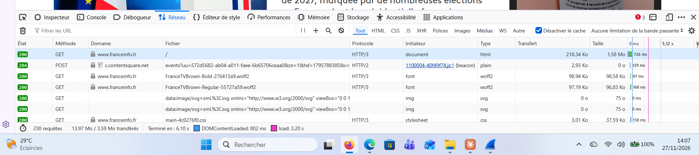

**Observations :**
- La page HTML seule (`/`) fait **1,58 Mo**, mais seulement **218 Ko** transférés : le serveur la **compresse** (`Accept-Encoding: gzip, deflate, br, zstd`). C'est pour cela que le volume transféré (3,59 Mo) est bien plus faible que la taille réelle (13,97 Mo).
- Une page d'actualité fait plus de 200 requêtes, dont beaucoup vers des services tiers (statistiques, publicité).
- Le site utilise surtout **HTTP/3** (sur QUIC/UDP), qui envoie de nombreuses ressources en parallèle sur une seule connexion.

---

## Partie 2 — Installation de Wireshark

Wireshark installé sous Windows avec **Npcap**, option **Support loopback traffic** cochée : c'est elle qui fait apparaître l'interface *Adapter for loopback traffic capture* et permet de capturer les échanges avec `localhost`. Les captures ont été faites uniquement sur ma propre machine.

---

## Partie 3 — Analyse avec Wireshark

### Étapes 1 et 2 — Interface et capture

Interface **Adapter for loopback traffic capture**, filtre de capture `tcp port 80`. Pendant la capture, toutes les actions de la partie 1 ont été refaites dans Firefox (Ctrl+F5, GET, POST, 404, redirection, cache), puis la capture a été arrêtée et enregistrée dans `captures/tp2-http.pcapng` (272 paquets).

### Étape 3 — Filtre `http`

Le filtre d'affichage `http` ne garde que **54 paquets sur 272**. On retrouve tous les échanges de la partie 1, chaque requête suivie de sa réponse :

```
No.  Info
  4  GET /tp-http/formulaire.php HTTP/1.1
  6  HTTP/1.1 200 OK  (text/html)
 29  GET /tp-http/formulaire.php?nom=IBRAHIM HTTP/1.1
 31  HTTP/1.1 200 OK  (text/html)
 63  POST /tp-http/formulaire.php HTTP/1.1  (application/x-www-form-urlencoded)
 65  HTTP/1.1 200 OK  (text/html)
122  GET /tp-http/absent.php HTTP/1.1
124  HTTP/1.1 404 Not Found  (text/html)
133  GET /tp-http/redirige.php HTTP/1.1
135  HTTP/1.1 302 Found
137  GET /tp-http/formulaire.php HTTP/1.1
139  HTTP/1.1 200 OK  (text/html)
254  GET /tp-http/statique.html HTTP/1.1
256  HTTP/1.1 200 OK  (text/html)
265  GET /tp-http/statique.html HTTP/1.1
267  HTTP/1.1 304 Not Modified
```

(Les requêtes `GET /favicon.ico` apparaissent aussi.) Le filtre n'efface rien : la barre d'état indique « Paquets : 272 · Affichés : 54 ».

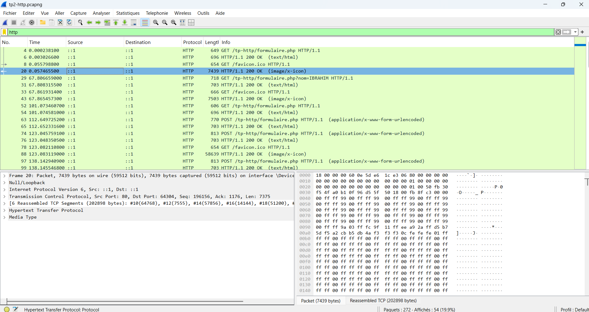

### Étape 4 — Les couches (paquet n° 4, la requête GET)

| Couche (cours, ch. 1.4) | Ligne dans Wireshark | Information relevée |
| --- | --- | --- |
| Accès réseau | *Null/Loopback* | Pas de trame Ethernet sur la boucle locale ; en-tête *Null/Loopback* (famille IPv6) |
| Internet | *Internet Protocol Version 6* | Source `::1` → Destination `::1` (l'équivalent IPv6 de `127.0.0.1`) |
| Transport | *Transmission Control Protocol* | Port source **64304** (port éphémère choisi par le client) → Port destination **80** |
| Application | *Hypertext Transfer Protocol* | `GET /tp-http/formulaire.php HTTP/1.1`, `Host: localhost`, `User-Agent: ... Firefox/161.0`, `Accept`, `Accept-Language`, `Connection: keep-alive`… |

Dans le panneau des octets, on lit en clair `GET /tp-http/formulaire.php HTTP/1.1`, `Host: localhost` et le `User-Agent` de Firefox.

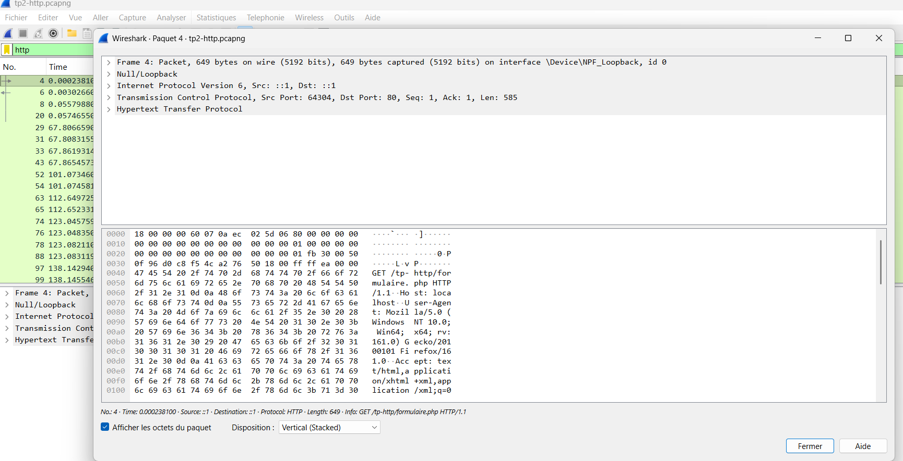

**Remarque :** `localhost` a été résolu en **IPv6 (`::1`)** et non en `127.0.0.1` : Windows préfère IPv6 quand il est disponible.

### Étape 5 — Poignée de main TCP (filtre `tcp.stream eq 0`)

| N° | Temps (s) | Sens | Paquet |
| --- | --- | --- | --- |
| 1 | 0,000000 | client → serveur | `[SYN] Seq=0` |
| 2 | 0,000076 | serveur → client | `[SYN, ACK] Seq=0 Ack=1` |
| 3 | 0,000109 | client → serveur | `[ACK] Seq=1 Ack=1` |
| 4 | 0,000238 | client → serveur | `GET /tp-http/formulaire.php` (585 octets) |
| 6 | 0,003027 | serveur → client | `HTTP/1.1 200 OK` (632 octets) |
| 8 → 21 | 0,056 → 0,057 | | `GET /favicon.ico` et sa réponse (202 Ko), **sur la même connexion** |
| 22 | 5,066534 | serveur → client | `[FIN, ACK]` (fin du *keep-alive*) |
| 23 | 5,066601 | client → serveur | `[ACK]` |
| 24 | 5,066801 | client → serveur | `[FIN, ACK]` |
| 25 | 5,066853 | serveur → client | `[ACK]` |

```
   Client [::1]:64304                                Serveur [::1]:80 (Apache)
        |                                                   |
        | ---- [SYN] Seq=0 -------------------------------> |  1. demande d'ouverture
        | <--- [SYN, ACK] Seq=0 Ack=1 --------------------- |  2. acceptation
        | ---- [ACK] Seq=1 Ack=1 -------------------------> |  3. connexion établie
        |                                                   |
        | ---- GET /tp-http/formulaire.php ---------------> |  requête HTTP (585 octets)
        | <--- [ACK] -------------------------------------- |
        | <--- HTTP/1.1 200 OK ---------------------------- |  réponse HTTP (632 octets)
        | ---- [ACK] -------------------------------------> |
        |                                                   |
        | ---- GET /favicon.ico --------------------------> |  même connexion (keep-alive)
        | <--- HTTP/1.1 200 OK (202 Ko, plusieurs segments) |
        |                                                   |
        |      ... connexion gardée ouverte 5 s ...         |  Keep-Alive: timeout=5
        |                                                   |
        | <--- [FIN, ACK] --------------------------------- |  le serveur ferme (t = 5,07 s)
        | ---- [ACK] -------------------------------------> |
        | ---- [FIN, ACK] --------------------------------> |  le client ferme
        | <--- [ACK] -------------------------------------- |
```

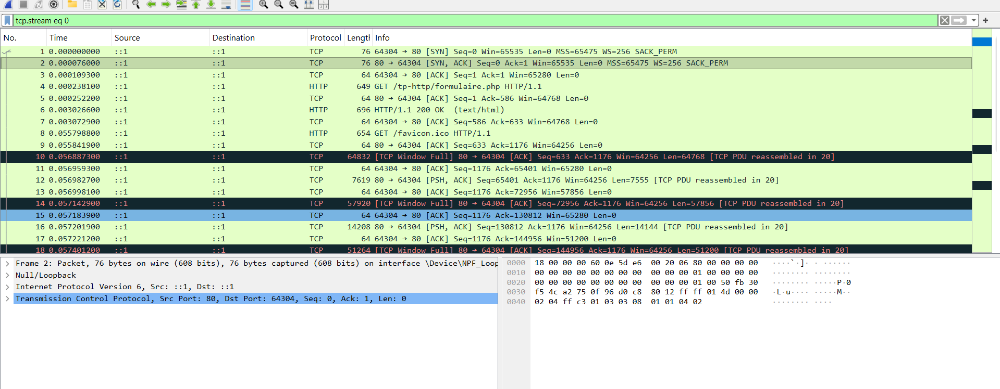

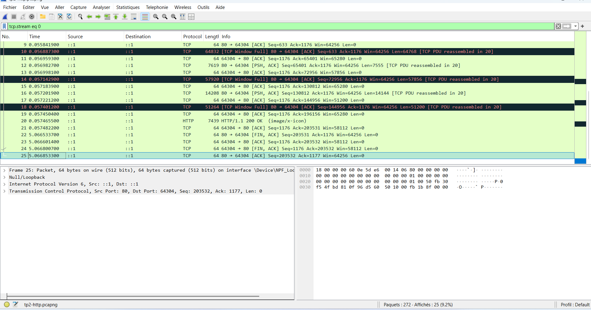

**Observations :**
- En local, la poignée de main prend **0,1 ms** : il n'y a pas de réseau à traverser.
- Apache annonce `Keep-Alive: timeout=5` et ferme effectivement la connexion **5 secondes** après la dernière réponse. Entre-temps, la même connexion a servi aussi pour `favicon.ico` : c'est l'intérêt du *keep-alive*, qui évite une nouvelle poignée de main.
- Sur Internet (étape 9), le `[SYN]` → `[SYN, ACK]` vers Wikipédia a pris **112 ms** : c'est la latence réseau.

### Étape 6 — Suivre le flux TCP

Clic droit sur le paquet 4 > *Suivre* > *Flux TCP* (texte dans `captures/flux-tcp.txt`) :

```
GET /tp-http/formulaire.php HTTP/1.1
Host: localhost
User-Agent: Mozilla/5.0 (Windows NT 10.0; Win64; x64; rv:161.0) Gecko/20100101 Firefox/161.0
Accept: text/html,application/xhtml+xml,application/xml;q=0.9,*/*;q=0.8
Accept-Language: fr,fr-FR;q=0.9,en-US;q=0.8,en;q=0.7
Accept-Encoding: gzip, deflate, br, zstd
Connection: keep-alive
Cookie: MasteriyoLearnPageWelcomeMessage-41-1569=shown
Upgrade-Insecure-Requests: 1
Sec-Fetch-Dest: document
Sec-Fetch-Mode: navigate
Sec-Fetch-Site: none
Sec-Fetch-User: ?1
Priority: u=0, i
Pragma: no-cache
Cache-Control: no-cache

HTTP/1.1 200 OK
Date: Fri, 27 Nov 2026 15:01:26 GMT
Server: Apache/2.4.65 (Win64) PHP/8.3.28 mod_fcgid/2.3.10-dev
X-Powered-By: PHP/8.3.28
Content-Length: 370
Keep-Alive: timeout=5, max=100
Connection: Keep-Alive
Content-Type: text/html; charset=UTF-8

<!DOCTYPE html>
<html lang="fr">
<head><meta charset="UTF-8"><title>Test HTTP</title></head>
<body>
  <h1>Bonjour </h1>
  ...
```

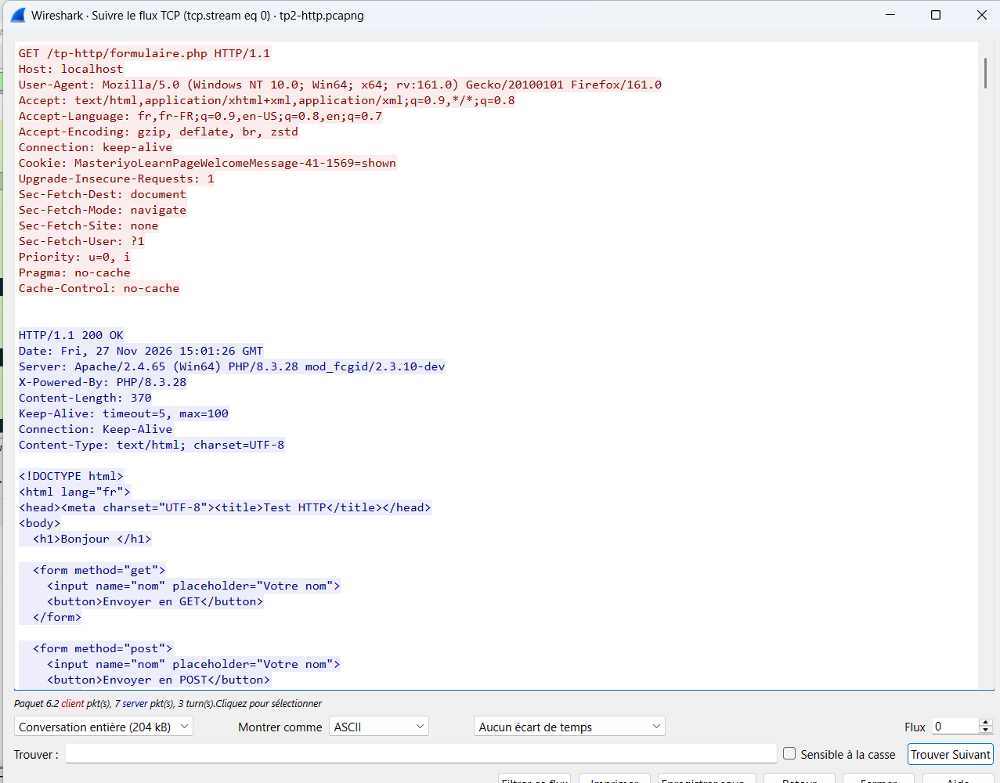

**Comparaison avec le navigateur :** c'est le même échange, mais brut. On voit l'**ordre réel** des en-têtes tels que Firefox les a envoyés (Firefox, lui, les affiche triés par ordre alphabétique), la **ligne vide** (`\r\n`) qui sépare en-têtes et corps, et le HTML exact renvoyé, octet par octet. La suite du flux montre la requête `GET /favicon.ico` passée sur la même connexion.

### Étape 7 — Formulaire POST en clair

Filtre `http.request.method == "POST"` → paquet n° 63, *HTML Form URL Encoded* :

```
Form item: "nom" = "Ibrahim"
```

Le corps de la requête (`6e6f6d3d4962726168696d` en hexadécimal, soit `nom=Ibrahim`) est **lisible en clair** par quiconque capture le trafic. Un mot de passe envoyé de la même façon le serait tout autant : d'où la règle **HTTPS partout**.

### Étape 8 — Résolution DNS

Capture sur l'interface **Wi-Fi**, sans filtre de capture, pendant la commande `nslookup www.wikipedia.org` puis l'ouverture de `https://fr.wikipedia.org` dans Firefox. Pour ne pas publier le reste du trafic de la machine, seuls les échanges DNS et Wikipédia ont été conservés dans `captures/tp2-dns-https.pcapng` (1 718 paquets).

Résultat de `nslookup` :

```
Serveur :   La_Fibre_Orange.Home
Address:  fe80::1

DNS request timed out.
    timeout was 2 seconds.
DNS request timed out.
    timeout was 2 seconds.
Réponse ne faisant pas autorité :
Nom :    dyna.wikimedia.org
Addresses:  2a02:ec80:300:ed1a::1
          185.15.59.224
Aliases:  www.wikipedia.org
```

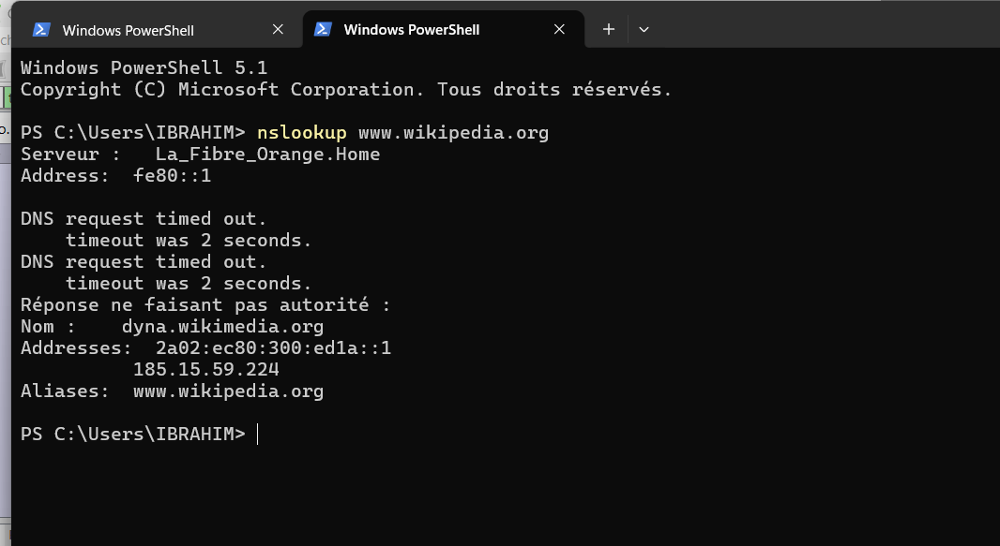

Wireshark, filtre `dns` :

```
1  Standard query 0x0002 A www.wikipedia.org.Home
2  Standard query 0x0003 AAAA www.wikipedia.org.Home
3  Standard query 0x0004 A www.wikipedia.org
4  Standard query response 0x0004 A www.wikipedia.org CNAME dyna.wikimedia.org A 185.15.59.224
5  Standard query 0x0005 AAAA www.wikipedia.org
6  Standard query response 0x0005 AAAA www.wikipedia.org CNAME dyna.wikimedia.org AAAA 2a02:ec80:300:ed1a::1
7  Standard query response 0x0002 Refused A www.wikipedia.org.Home
8  Standard query response 0x0003 Refused AAAA www.wikipedia.org.Home
```

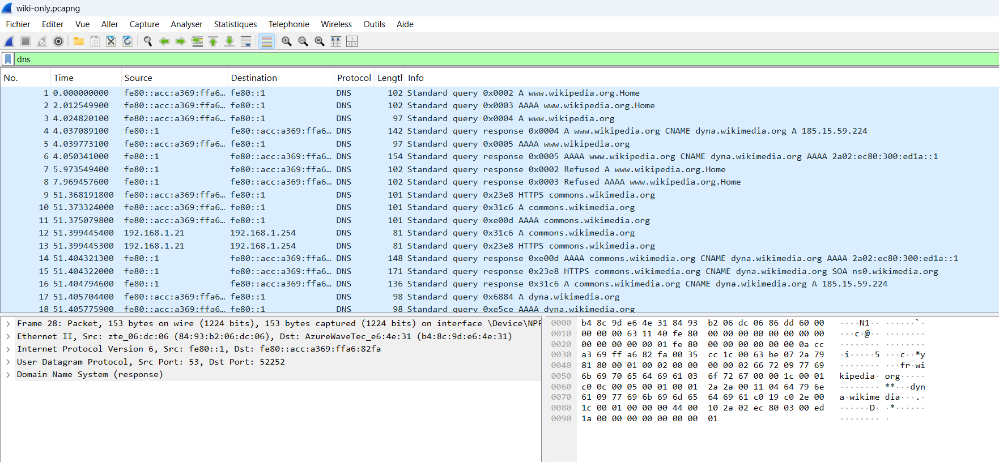

**Comparaison :** les mêmes adresses que `nslookup`. Le nom `www.wikipedia.org` est un **alias (CNAME)** de `dyna.wikimedia.org`, qui a une adresse IPv4 (requête `A`) et une adresse IPv6 (requête `AAAA`). Le serveur DNS interrogé est la box Internet (`fe80::1`).

Wireshark montre aussi ce que `nslookup` ne montre pas :
- `nslookup` a d'abord demandé `www.wikipedia.org.Home` (ajout automatique du suffixe DNS local). La box a répondu **Refused**, mais seulement 6 et 8 secondes plus tard (paquets 7 et 8) : d'où les deux messages *DNS request timed out*.
- À l'ouverture de `fr.wikipedia.org`, Firefox envoie **trois requêtes en même temps** : `A`, `AAAA` et `HTTPS` (un type d'enregistrement qui annonce les protocoles du serveur), et toutes mènent au même `dyna.wikimedia.org`.

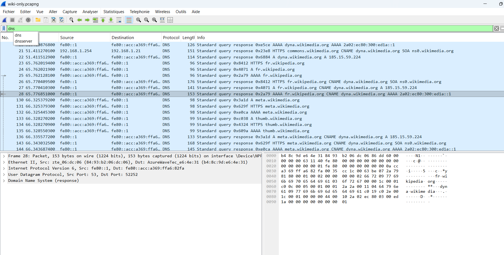

### Étape 9 — Ce que change HTTPS

Ouverture de `https://fr.wikipedia.org` dans Firefox, filtre `tcp.stream eq 0` (première connexion) puis `tls` :

| N° | Ce qu'on voit |
| --- | --- |
| 29 → 33 → 35 | Poignée de main TCP vers le port **443** de `2a02:ec80:300:ed1a::1`, avec **112 ms** entre `[SYN]` et `[SYN, ACK]` |
| 38 | **`Client Hello (SNI=fr.wikipedia.org)`** : le nom du site est **visible en clair**. ALPN proposé : `h2, http/1.1` |
| 50 | `Server Hello` : la connexion passe en **TLS 1.3** |
| 53 → 68 | **Application Data** : contenu **illisible** (`Encrypted Application Data: 93409e188eb5cdf…`) |
| 69 | `[FIN, ACK]` : fermeture |

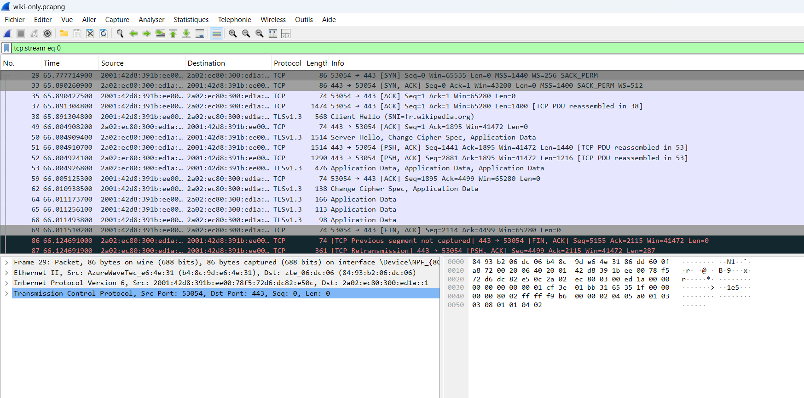

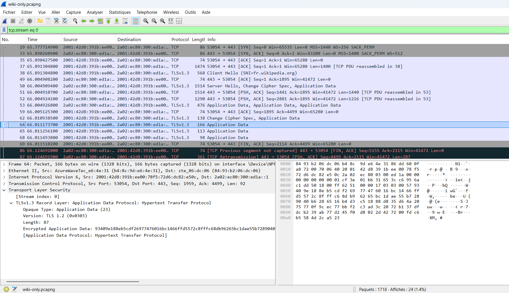

Dans les paquets *Application Data*, on ne voit ni l'URL (`/wiki/...`), ni la méthode, ni les en-têtes, ni les cookies, ni le contenu. Pour afficher la page, Firefox a ouvert **22 connexions TLS**, avec des SNI `fr.wikipedia.org`, `upload.wikimedia.org`, `thumb.wikimedia.org` et `auth.wikimedia.org` : on voit donc **quels serveurs** sont contactés, mais pas **ce qui est demandé**. Ici, la connexion utilisait TLS sur TCP et le filtre `quic` ne renvoyait rien pour Wikipédia.

### Étape 10 — Enregistrement

- `captures/tp2-http.pcapng` : boucle locale, port 80 (étapes 2 à 7)
- `captures/tp2-dns-https.pcapng` : Wi-Fi, DNS et HTTPS (étapes 8 et 9)

Ces captures ne contiennent pas de mot de passe. Elles contiennent en revanche des adresses IPv6 de la machine et un cookie local, ce qui est une raison de plus de ne les partager qu'avec prudence.

---

## Réponses aux questions

**1. Pourquoi HTTP est-il sans état ? Comment le serveur reconnaît-il malgré tout un visiteur ?**
Chaque requête HTTP est traitée indépendamment : le serveur ne garde aucun souvenir des requêtes précédentes. On l'a vu dans la capture : le GET et le POST sont passés par **des connexions TCP différentes**, et rien dans le protocole ne les relie. Pour reconnaître un visiteur, on ajoute de l'état **au-dessus** de HTTP grâce aux **cookies**. Le serveur envoie `Set-Cookie: PHPSESSID=...`, que le navigateur renvoie à chaque requête (`Cookie: ...`), comme le cookie `MasteriyoLearnPageWelcomeMessage-...` observé à chaque requête vers `localhost`. Côté PHP, `session_start()` associe cet identifiant aux données de session stockées sur le serveur. On peut aussi utiliser un jeton (`Authorization: Bearer ...`).

**2. Où sont les données d'un formulaire en GET ? en POST ? L'une est-elle sûre sans HTTPS ?**
En **GET**, dans l'**URL** (`?nom=IBRAHIM`) : elles sont visibles dans la barre d'adresse, l'historique, les favoris et les journaux du serveur. En **POST**, dans le **corps** de la requête (`nom=Ibrahim`, encodé en `application/x-www-form-urlencoded`, `Content-Length: 11`). **Aucune des deux n'est sûre sans HTTPS** : POST évite seulement que les données apparaissent dans l'URL, mais l'étape 7 de Wireshark montre `"nom" = "Ibrahim"` en clair sur le réseau.

**3. Que contient la réponse à une requête `HEAD` ?**
Uniquement la ligne de statut et les **en-têtes**, **sans corps**. Résultat de `curl.exe -I http://localhost/tp-http/formulaire.php` :

```
HTTP/1.1 200 OK
Date: Fri, 27 Nov 2026 17:19:02 GMT
Server: Apache/2.4.65 (Win64) PHP/8.3.28 mod_fcgid/2.3.10-dev
X-Powered-By: PHP/8.3.28
Content-Type: text/html; charset=UTF-8
```

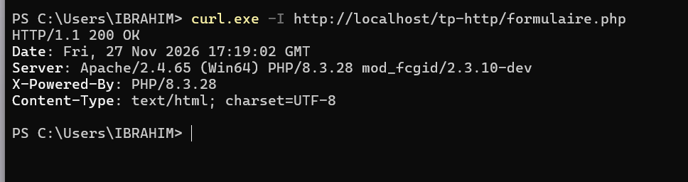

`HEAD` sert à vérifier qu'une ressource existe, ou à connaître son type, sa taille ou sa date de modification sans la télécharger.

**4. Combien de paquets pour ouvrir une connexion TCP ? À quoi sert chacun ?**
**Trois** (paquets 1, 2 et 3 de `tp2-http.pcapng`) :
1. `[SYN]` : le client demande l'ouverture et annonce son numéro de séquence initial (et ses options : MSS, fenêtre).
2. `[SYN, ACK]` : le serveur accepte, accuse réception du SYN (`Ack=1`) et annonce son propre numéro de séquence.
3. `[ACK]` : le client accuse réception du SYN du serveur. La connexion est établie dans les deux sens et HTTP peut commencer.

**5. Pour un site en HTTPS, que montre Wireshark et que cache-t-il ?**
- *Visible :* les requêtes DNS (`fr.wikipedia.org` → `185.15.59.224` / `2a02:ec80:300:ed1a::1`), les adresses IP, le port 443, la poignée de main TCP, le **nom du site** (SNI `fr.wikipedia.org` dans le *Client Hello*), les protocoles proposés (ALPN `h2, http/1.1`), la version TLS, ainsi que l'heure, le nombre et la **taille** des paquets, et la liste des serveurs contactés.
- *Caché :* l'URL complète (chemin et paramètres), la méthode, les en-têtes HTTP (dont les cookies), le contenu des pages et les données des formulaires, tout ce qui passe dans les paquets *Application Data*.
